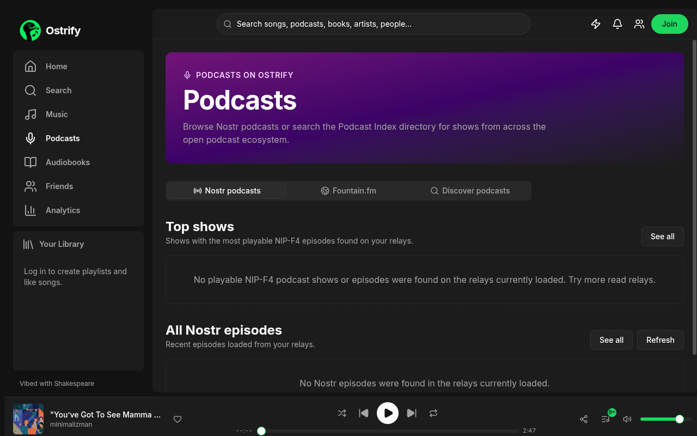
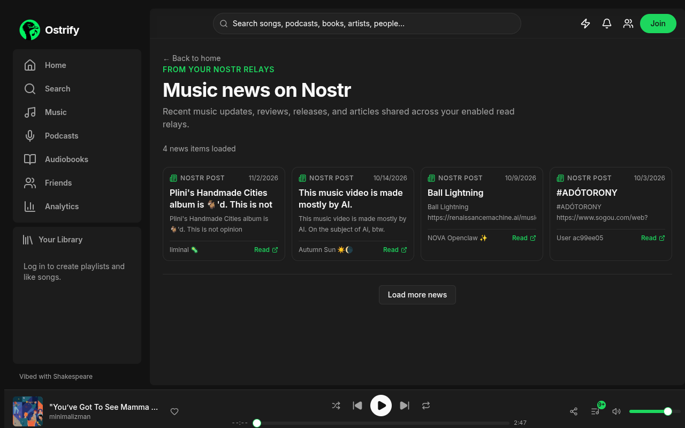
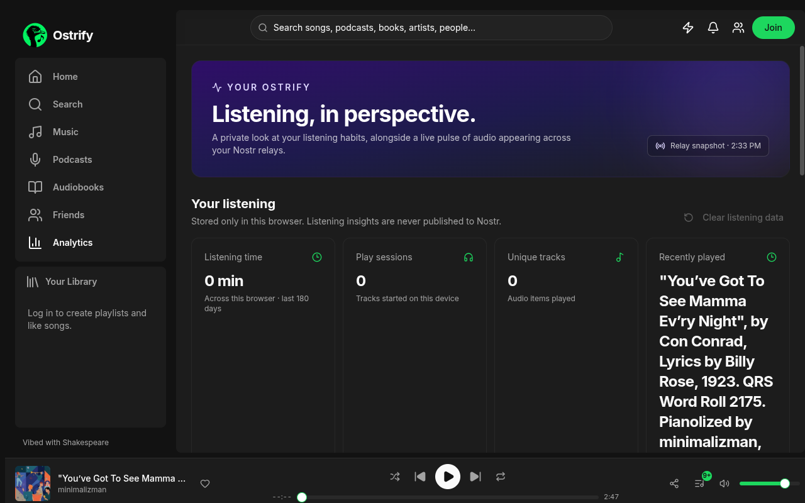
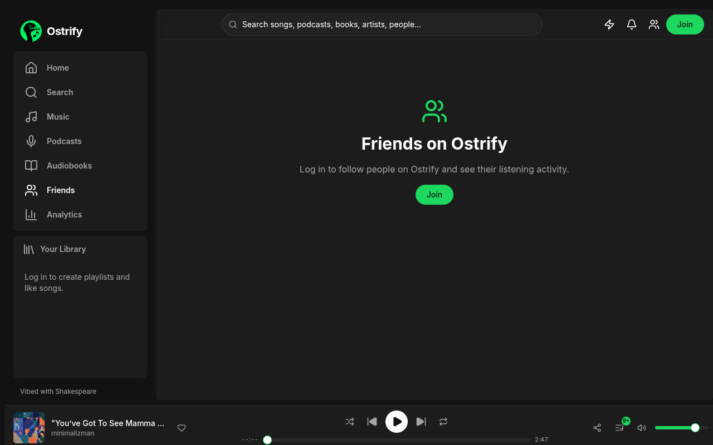
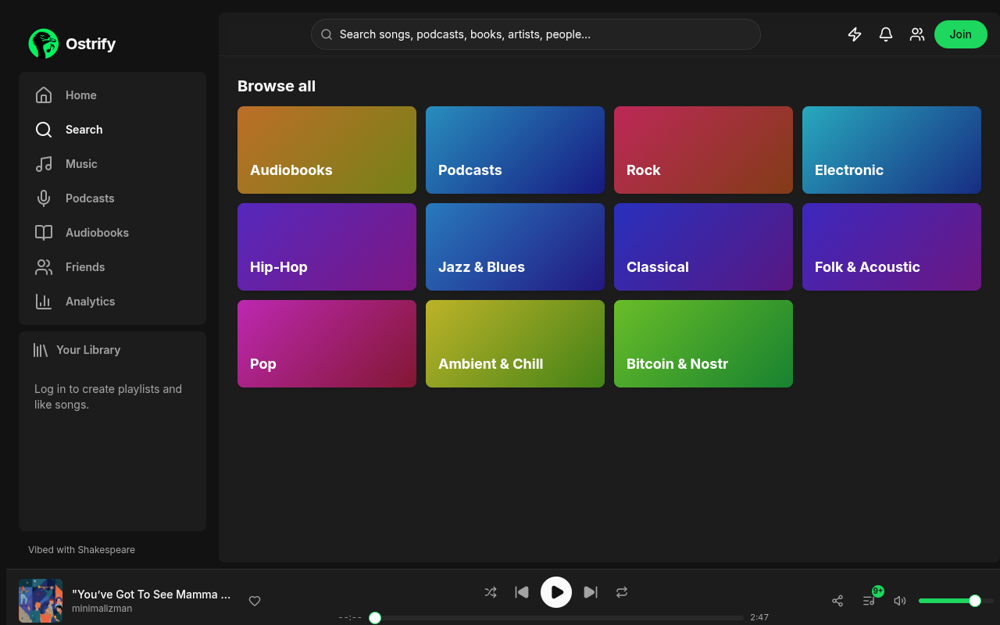
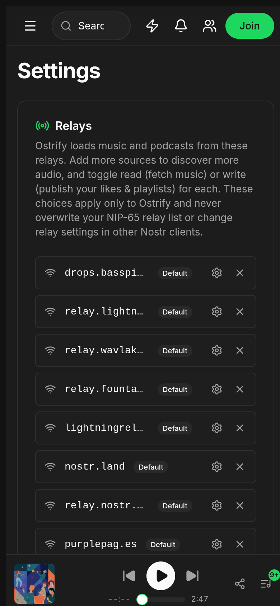

  
  <h1>Ostrify</h1>
  
<strong>Open-protocol audio. One player. Your Nostr identity.</strong>

  
Discover and listen to independent music, podcasts, live streams, and audiobooks—then build a library that belongs to you.

  

    <a href="https://ostrify.shakespeare.wtf">Open Ostrify</a>
    ·
    <a href="NIP.md">Nostr event formats</a>
  

  

    
  

---

Ostrify is an audio discovery and listening app built around [Nostr](https://nostr.com/), an open, decentralized protocol. It brings audio from Nostr relays together with independent music catalogs and open audiobook collections in a responsive web player.

There is no Ostrify account server. Sign in with a Nostr-compatible signer to publish and sync supported parts of your library. Your Nostr identity is your account; content and catalog availability depends on the relays, publishers, and services you use.

## A look around

### Music, artists, and albums

Explore Nostr-published audio, browse independent catalog music, and move from tracks into artists, publishers, albums, and genres.

### Podcasts

Browse Nostr podcasts, Fountain-linked shows and episodes, or search the Podcast Index directory for shows across the podcast ecosystem.

### Music news and listening insights

Catch up on music news shared across Nostr, and review private listening stats alongside an explicitly sampled view of relay activity.

| Music news | Listening insights |
| --- | --- |
|  |  |

### Friends and discovery

Find people who opted into the Ostrify directory, follow friends, and explore more audio from the Search page.

| Friends on Ostrify | Search and browse |
| --- | --- |
|  |  |

### Settings and relays

Choose which relays Ostrify reads from and publishes to, independently of your NIP-65 relay list. Manage profile visibility and other app preferences in one place.

## What you can do

### Discover audio

- **Home:** browse genre shelves, fresh Nostr tracks, a daily discovery mix, personalized recommendations, and music news from your relays. Open a genre’s full catalog with **See all**.
- **Music:** discover tracks from Nostr relays, explore the Wavlake catalog, and find TuneStr live streams and recordings. Browse artists and publishers, albums, and public Ostrify playlists.
- **Genres:** explore categories such as Rock, Electronic, Hip-Hop, Jazz & Blues, Classical, Folk & Acoustic, Pop, Ambient & Chill, and Bitcoin & Nostr.
- **Podcasts:** switch between Nostr podcasts, Fountain.fm, and Podcast Index discovery. Browse shows and episodes, search the directory, and save shows or episodes to your library.
- **Audiobooks:** browse and search LibriVox and the Project Gutenberg Open Audiobook Collection. Play a book’s available recordings in sequence and keep favorites and collections organized.
- **Search:** search across music, podcast shows and episodes, Wavlake tracks and artists, audiobooks, and opted-in Ostrify profiles.
- **Music news:** read recent music updates, reviews, releases, and articles shared across your enabled Nostr relays.

### Listen your way

- **Persistent player:** keep audio playing as you move around the app, with play/pause, skip, seek, volume, shuffle, repeat, and queue controls.
- **Queue and history:** manage what plays next, revisit recent listening, and resume playback from the same browser.
- **Track actions:** like tracks, add them to playlists, and use queue actions while browsing.
- **TuneStr video:** open Nostr live streams and recordings in Ostrify’s video player, with docked and full-screen viewing controls where supported.
- **Daily discovery:** give local feedback on recommendations with “More like this,” “Not for me,” and artist blocking controls.

### Make a library

- **Liked Songs and playlists:** create and organize music playlists, reorder tracks, and publish lists as Nostr events.
- **Follow artists:** keep track of Nostr and Wavlake artists in your own follow list.
- **Save podcasts:** keep shows and episodes together in your Nostr-synced podcast library.
- **Audiobook favorites and collections:** organize books on this device, and optionally sync the library privately across devices.
- **Public music profiles:** show selected library sections on your Ostrify profile, with controls for likes, artists, friends, playlists, and saved podcasts.
- **Public playlist discovery:** browse playlists shared by Ostrify listeners.

### Find people and share activity

- **Friends on Ostrify:** follow people, find accounts that opted into the Ostrify directory, and browse the public library sections they choose to share.
- **Private invites:** send NIP-17 encrypted friend invites to a Nostr public key. Recipients choose whether to follow you back.
- **Listening status:** optionally share what you’re listening to as a public NIP-38 status. Sharing is off by default.

### Personal listening insights

The Analytics page shows local listening time, play sessions, top tracks, and a seven-day overview, alongside a sampled snapshot of audio events visible on your read relays. Personal play history stays in the browser; relay counts are samples, not global network totals.

## Your identity, your data

Ostrify uses your selected Nostr signer for signing and encryption; the app does not access your private key directly.

- **Public on Nostr:** music playlists and likes, followed artists and people, directory listings, and profile visibility preferences are published as relay events. Profile controls change what Ostrify displays; they do not make published events private or erase relay copies.
- **Private audiobook sync:** audiobook favorites and collections are encrypted to your own public key with NIP-44 before being published as NIP-78 application data. Sync requires the same Nostr account on each device, a signer with NIP-44 support, and configured read and write relays. Existing browser-only saves are merged during first sync.
- **Optional public status:** when enabled, listening activity is published publicly. Ostrify sends a clearing status when possible, but relays or other clients may retain older copies.
- **Local to this browser:** playback queue, history, volume, position, listening analytics, and other playback preferences do not automatically sync. Audiobook library data is also cached locally.
- **Relay controls:** Ostrify’s read/write relay choices apply to this app only; they do not replace or overwrite your NIP-65 relay list.

Use relays you trust to retain application data. Features can vary with relay availability, publisher event formats, signer capabilities, and external catalog services.

## Sources and availability

Ostrify combines Nostr events with the Wavlake music catalog, Fountain, Podcast Index, LibriVox, Project Gutenberg, and Internet Archive. Each source has its own availability and terms. Podcast Index features require API credentials and a reachable server-side proxy; Fountain and other services can also be affected by upstream availability. Nostr music and podcast discovery depends on the relays you enable and the event formats publishers use.

For event kinds, tags, and Ostrify-specific conventions, see **[NIP.md](NIP.md)**.

## Links

- **Open the app:** [ostrify.shakespeare.wtf](https://ostrify.shakespeare.wtf)
- **Nostr event formats:** [NIP.md](NIP.md)
- **Edit with Shakespeare:** [Open this project in Shakespeare](https://shakespeare.diy/clone?url=https%3A%2F%2Fgithub.com%2Flothendriel%2Fostrify.git)

---

  Open protocols. Independent audio. Your library.
   
  <a href="https://shakespeare.diy">Vibed with Shakespeare</a>

