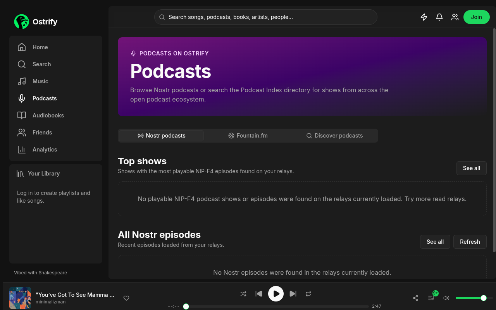
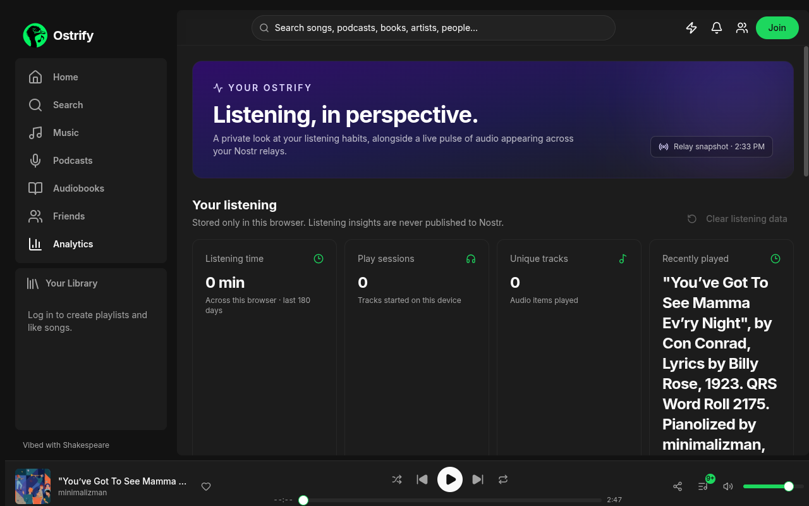
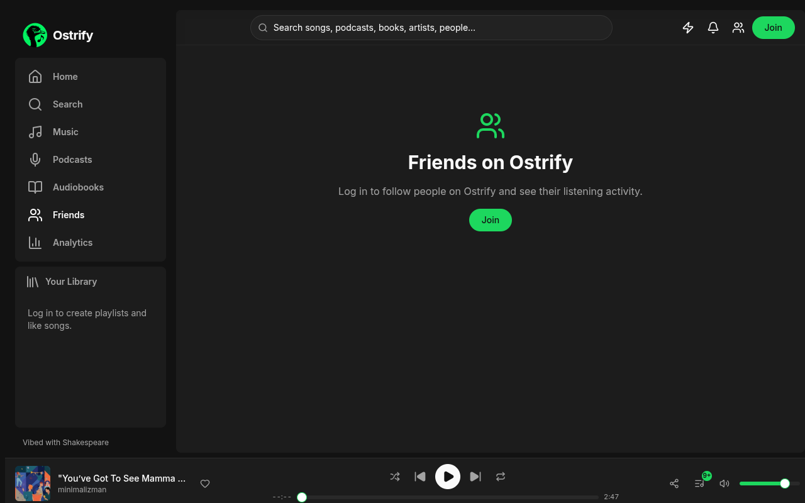
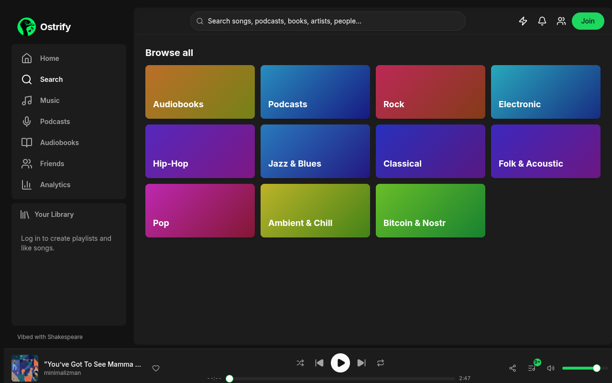

  
  <h1>Ostrify</h1>
  
<strong>Version 2</strong>

  
<strong>Open-protocol audio. One player. Your Nostr identity.</strong>

  
Discover and listen to independent music, podcasts, live streams, and audiobooks—then build a library that belongs to you.

  

    <a href="https://ostrify.studio314.us/">Open Ostrify</a>
    ·
    <a href="CHANGELOG.md">Changelog</a>
    ·
    <a href="NIP.md">Nostr event formats</a>
  

  

    
  

---

Ostrify is an audio discovery and listening app built around [Nostr](https://nostr.com/), an open, decentralized protocol. It brings audio published to Nostr relays together with independent music catalogs and open audiobook collections in a responsive web player.

There is no Ostrify account server. Sign in with a Nostr-compatible signer to publish and sync supported parts of your library. Your Nostr identity is your account; available content depends on your relays, publishers, and external services.

## Features

### Discover music and audio

- **Home:** jump back into recent listening, browse a personalized mix and daily discoveries, and explore fresh Nostr tracks, music news, podcasts, and genre shelves. Distant sections and their queries load as you scroll toward them. Home discovery keeps useful cached results visible while refreshing, tolerates relays that fail or respond slowly, and requests Wavlake genre catalogs where they can fill sparse shelves.
- **Personalized genre shelves:** explore Rock, Electronic, Hip-Hop, Jazz & Blues, Classical, Folk & Acoustic, Pop, Ambient & Chill, and General. Bitcoin & Nostr remains available from the Home genre links and its full category page, but is not shown as a Home shelf. Shelves favor tracks not shown recently, avoid repeating a track across the current selection where possible, and can be refreshed. Shelves with tracks are placed before empty shelves; use **See all** for a category’s full catalog.
- **Music and video:** discover playable tracks from enabled read relays and the shared DROPS relay; browse Wavlake music, TuneStr live streams and recordings, and Odysee music videos; and explore artists, publishers, albums, releases, and public Ostrify playlists. Odysee videos play through an embedded player and can also be opened at their source. Catalog and relay results may be partial and depend on source availability.
- **Podcasts:** browse Nostr shows and episodes, Fountain-linked shows and RSS episodes, or Podcast Index directory results. Search Nostr and Fountain catalogs, open show pages, select episodes for the queue, and save shows or episodes to your library. Cached lookups and progressive results help surface available matches without waiting for every source.
- **Audiobooks:** search and browse volunteer-read LibriVox books and AI-narrated selections from the Project Gutenberg Open Audiobook Collection. Play available recordings in sequence, save favorites, and organize collections.
- **Local Radio:** search Radio Browser stations by name, country, or region, play compatible live streams, and save favorite stations. Stream availability varies by station and browser.
- **Search:** search loaded music, podcasts, Wavlake tracks and artists, audiobooks, and Ostrify profiles that opted into the public directory.
- **Music news:** read recent music updates, reviews, releases, and articles shared on your relays.

### Listen and manage playback

- **Persistent player:** audio continues as you navigate. Use play/pause, previous/next, seek, volume, shuffle, autoplay, repeat, and queue controls. A green animation circles the player-bar button during playback. The listening room includes track actions and a full-screen visualizer for compatible audio.
- **Queue and history:** manage upcoming tracks, revisit recent listening, and resume playback from this browser. Playback sessions and the queue are scoped to the active Nostr account.
- **Track actions and sharing:** like tracks, add supported audio to playlists, use queue actions while browsing, and share audio or pages to Nostr. Audio shares use compact links and can resolve back to a playable track.
- **Video player:** play supported TuneStr live streams and recordings and Odysee music videos in an expanded or docked player, with adjustable sizes. Video playback coordinates with the audio player; save TuneStr recordings to your library.
- **Shared volume:** the player-bar volume and mute controls also apply to videos played directly by Ostrify, and native video volume controls update the shared setting. Odysee and other third-party embedded players use their own controls and cannot be muted from Ostrify’s player bar.
- **Support creators:** send Lightning payments or Nostr zaps to available artist or publisher recipients from the player, using a compatible browser wallet or a Lightning invoice. The video player offers a zap button for Nostr stream publishers with a usable Lightning payment method. Odysee videos do not currently provide a verified Nostr payment recipient in Ostrify. Availability depends on recipient and wallet support.
- **Daily Discovery:** get a locally personalized selection and give feedback with **More like this**, **Not for me**, and artist-blocking controls.
- **Analytics:** review private, browser-local listening time, sessions, format breakdowns, top tracks, and a seven-day overview. The Nostr network pulse shows a sampled view of playable audio events and publishers returned by enabled read relays; these are not global counts.

### Build a library and publish music

- **Liked Songs and playlists:** create, edit, organize, and reorder playlists; publish supported lists as Nostr events; and browse public Ostrify playlists.
- **Saved Music:** browse Liked Songs and saved albums together. Bookmark Wavlake and Nostr publisher albums in a Nostr-synced library, with per-album visibility controls for Ostrify profiles.
- **Follow artists and people:** keep artist follows separate from Ostrify follows, view followed artists, follow Ostrify accounts, and find people who opted into the directory.
- **Saved podcasts:** keep shows and episodes together in a Nostr-synced library; saved state is shown on podcast show and episode pages.
- **Audiobook library:** organize favorites and collections on this device and automatically sync them privately across browsers when signed in with a compatible Nostr signer.
- **Favorite radio stations:** save Radio Browser stations in your library and sync them privately across devices with a compatible Nostr signer.
- **Library sync status:** library pages show relay checks, incomplete results, and retry and relay-settings controls. Available data can still be shown when some relays do not respond; check again before making changes on another device. A successful read does not guarantee that relays retained every update.
- **Public music profile:** choose which supported library sections Ostrify displays on your profile.
- **Publish music:** upload a track or multi-track album through a configured Blossom server, or publish an HTTPS audio URL. Add artwork and genre metadata, reuse and reorder previously published tracks, and choose whether each track is shown in Ostrify.
- **My Uploads:** review and paginate through your published tracks, then change Ostrify visibility for individual tracks or albums. A visibility change is not a deletion or a way to make a public Nostr event private.
- **DROPS sharing:** public music uploads are also sent to the shared DROPS relay for Ostrify discovery. Publishing reports sharing outcomes and can help share eligible existing public tracks.

### Friends, privacy, and settings

- **Friends on Ostrify:** follow accounts, browse the public profile sections they choose to display, and discover opt-in directory listings. Friend listening activity can be viewed from the Friends page or activity panel.
- **Private invites:** send NIP-17 encrypted friend invites to a Nostr public key; the recipient chooses whether to follow you back.
- **Listening status:** share the current track or video as a public NIP-38 status. Sharing is on by default for signed-in accounts without a saved preference; existing off choices are respected. Turn it off per account on this device, and Ostrify reports whether it could publish a clearing update. For embedded video, the status reports that the video is open because playback and pauses cannot be reliably detected.
- **Relay controls:** manage Ostrify’s recommended read/write relays and Blossom upload servers separately. Optionally include your NIP-65 read relays for broader discovery; Ostrify-specific exclusions do not change your published NIP-65 list.
- **Privacy and appearance:** opt into or withdraw from the public Ostrify directory, choose which library sections appear on your profile, and select light or dark appearance. In December, Home displays a responsive wreath and twinkling lights, and the player-bar play icon becomes a Christmas tree; these disappear automatically afterward.

## A look around

### Music, artists, and albums

Explore Nostr-published audio, browse independent catalog music, and move from tracks into artists, publishers, albums, and genres.

### Podcasts

Browse Nostr podcasts, Fountain.fm shows and episodes, or Podcast Index directory results.

### Music news and listening insights

Catch up on music news shared across Nostr, and review private listening stats alongside a sampled view of relay activity.

| Music news | Listening insights |
| --- | --- |
|  |  |

### Friends and discovery

Find people who opted into the Ostrify directory, follow friends, and explore more audio from Search.

| Friends on Ostrify | Search and browse |
| --- | --- |
|  |  |

### Settings and relays

Choose which relays Ostrify reads from and publishes to, independently of your NIP-65 relay list. Manage Blossom servers, directory and profile visibility, listening status, and appearance preferences.

## Your identity and data

Ostrify uses your selected Nostr signer for signing and encryption; the app does not access your private key directly.

- **Public on Nostr:** playlists and likes, followed artists and people, directory listings, and profile visibility preferences are published as relay events. Profile controls affect what Ostrify displays; they do not make published events private or erase relay copies.
- **Shared audio catalog:** while people browse, Ostrify may forward eligible playable public Nostr audio events unchanged to its shared relay at `wss://relay.studio314.us/nostrrelay/ostrify`. No new user-authored event or index record is made; original signatures and authorship are preserved. A relay may reject the event, and acceptance does not guarantee retention. This does not forward events to other write relays.
- **Music visibility is not privacy:** tracks marked **Hidden in Ostrify** are omitted from Ostrify discovery and are not forwarded to the Ostrify catalog relay or DROPS. The track event and its media URL remain public on configured write relays, and relays or other clients may retain older public copies.
- **Private audiobook sync:** favorites and collections are encrypted to your own public key with NIP-44 before publication as NIP-78 application data. Sync requires the same Nostr account on each device, a signer with NIP-44 support, and reachable write relays that retain the data. Existing browser-only saves are merged during initial sync. If your books were saved before sync, open Ostrify in the original browser and sign in to upload them first; check Saved Audiobooks for any sync errors.
- **Private radio favorites:** station favorites are encrypted to your own public key with NIP-44 and synced as NIP-78 data. The same Nostr account, a compatible signer, and reachable write relays that retain the data are required. Open the original browser and sign in first to import its existing favorites; check Favorite Radio for sync errors. Browser-only favorites are claimed by the first account that signs in on that browser.
- **Public listening status:** sharing is on by default for signed-in accounts with no saved preference and can be turned off in Settings on each device. Ostrify attempts to clear the current status when sharing is disabled, but a failed update or retained relay copies can leave an earlier status visible. Embedded video status indicates the video is open, not necessarily playing.
- **Local to this browser:** playback queue, history, volume, position, listening analytics, and playback preferences do not automatically sync. Audiobook data is also cached locally.
- **Relay controls:** Ostrify’s read and write relay choices apply only to this app; they do not replace or overwrite your NIP-65 relay list.

Use relays you trust to retain application data. Features vary with relay availability, publisher event formats, signer capabilities, and external catalog services.

## Sources and availability

Ostrify combines Nostr events with the Wavlake catalog, the shared DROPS relay, Odysee, Radio Browser, Fountain, Podcast Index, LibriVox, Project Gutenberg, and Internet Archive. Each source has its own availability and terms. Podcast Index discovery requires API credentials and a reachable server-side proxy. Fountain and other services can be affected by upstream availability. Nostr discovery depends on the relays you enable and the event formats publishers use. Relay samples and search results are not guaranteed to be complete or global.

For event kinds, tags, and Ostrify-specific conventions, see **[NIP.md](NIP.md)**.

## Links

- **Open the app:** [ostrify.studio314.us](https://ostrify.studio314.us/)
- **Changelog:** [CHANGELOG.md](CHANGELOG.md)
- **Nostr event formats:** [NIP.md](NIP.md)

---

  Open protocols. Independent audio. Your library.
   
  <a href="https://shakespeare.diy">Vibed with Shakespeare</a>

