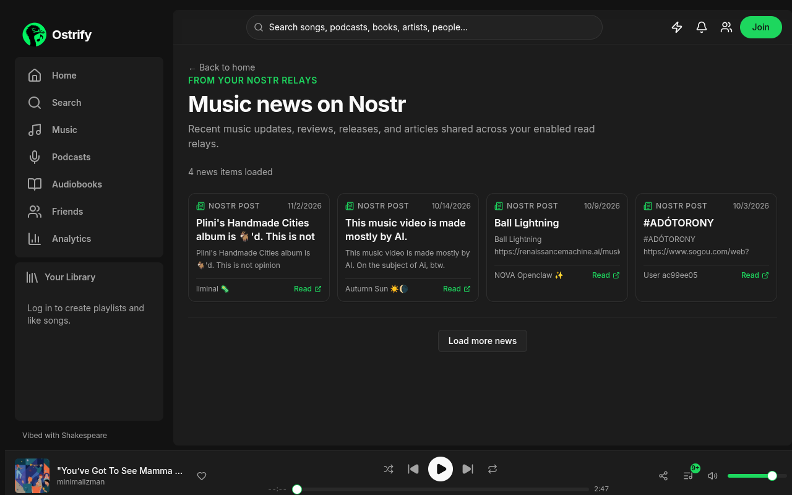
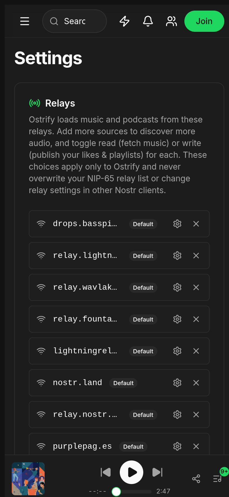

  
  <h1>Ostrify</h1>
  
<strong>Open-protocol audio. One player. Your Nostr identity.</strong>

  
Discover and listen to independent music, podcasts, live streams, and audiobooks—then build a library that belongs to you.

  

    <a href="https://ostrify.shakespeare.wtf">Open Ostrify</a>
    ·
    <a href="CHANGELOG.md">Changelog</a>
    ·
    <a href="NIP.md">Nostr event formats</a>
  

  

    
  

---

Ostrify is an audio discovery and listening app built around [Nostr](https://nostr.com/), an open, decentralized protocol. It brings audio published to Nostr relays together with independent music catalogs and open audiobook collections in a responsive web player.

There is no Ostrify account server. Sign in with a Nostr-compatible signer to publish and sync supported parts of your library. Your Nostr identity is your account; available content depends on your relays, publishers, and external services.

## Features

### Discover music and audio

- **Home:** browse genre shelves, fresh Nostr tracks, personalized recommendations, daily discoveries, music news, and podcasts. Sections and their data load as you approach them while scrolling.
- **Music:** find tracks on your enabled Nostr relays and the shared DROPS music relay, browse the Wavlake catalog, discover TuneStr live streams and recordings, and explore artists, publishers, albums, and public Ostrify playlists.
- **Genres:** browse Rock, Electronic, Hip-Hop, Jazz & Blues, Classical, Folk & Acoustic, Pop, Ambient & Chill, and Bitcoin & Nostr; open a category’s full catalog with **See all**.
- **Podcasts:** browse Nostr episodes and shows, Fountain-linked shows and RSS episodes, or search the Podcast Index directory. Save shows and episodes to your library.
- **Audiobooks:** search and browse LibriVox and the Project Gutenberg Open Audiobook Collection, play available recordings in sequence, and save favorites or organize collections.
- **Search:** search loaded music, podcasts, Wavlake tracks and artists, audiobooks, and Ostrify profiles that opted into the public directory.
- **Music news:** read recent music updates, reviews, releases, and articles shared on your relays.

### Listen and manage playback

- **Persistent player:** audio continues as you navigate. Use play/pause, previous/next, seek, volume, shuffle, repeat, and queue controls.
- **Queue and history:** manage upcoming tracks, revisit recent listening, and resume playback from this browser.
- **Track actions:** like tracks, add supported audio to playlists, or use queue actions while browsing.
- **TuneStr video:** play supported live streams and recordings in a docked or full-screen player.
- **Daily Discovery:** give local recommendations feedback with **More like this**, **Not for me**, and artist-blocking controls.
- **Analytics:** review local listening time, sessions, top tracks, and a seven-day overview, alongside a sampled view of audio events returned by your read relays.

### Build a library and publish music

- **Liked Songs and playlists:** create, organize, and reorder playlists; publish supported lists as Nostr events; and browse public Ostrify playlists.
- **Saved albums:** bookmark Wavlake and Nostr publisher albums in a Nostr-synced library, with per-album visibility controls for Ostrify profiles.
- **Follow artists and people:** keep a separate artist list, follow Ostrify accounts, and find people who opted into the directory.
- **Saved podcasts:** keep shows and episodes together in a Nostr-synced library.
- **Audiobook library:** organize favorites and collections on this device, and optionally sync them privately across devices.
- **Public music profile:** choose which supported library sections Ostrify displays on your profile.
- **Publish music:** upload a track or a multi-track album through a configured Blossom server, or publish an HTTPS audio URL. Add artwork and genre metadata, reuse and reorder previously published tracks, and choose whether each track is shown in Ostrify.
- **My Uploads:** review your published tracks, paginate through them, and change Ostrify visibility individually or for albums. A visibility change is not a deletion or a way to make a public Nostr event private.
- **DROPS sharing:** public music uploads are also sent to the shared DROPS relay for Ostrify discovery. The publishing interface reports outcomes and can help share eligible existing public tracks.

### Friends and activity

- **Friends on Ostrify:** follow accounts, browse public profile sections they choose to display, and discover opt-in directory listings.
- **Private invites:** send NIP-17 encrypted friend invites to a Nostr public key; the recipient chooses whether to follow you back.
- **Listening status:** optionally share the current track as a public NIP-38 status. Sharing is off by default.

## A look around

### Music, artists, and albums

Explore Nostr-published audio, browse independent catalog music, and move from tracks into artists, publishers, albums, and genres.

### Podcasts

Browse Nostr podcasts, Fountain.fm shows and episodes, or Podcast Index directory results.

### Music news and listening insights

Catch up on music news shared across Nostr, and review private listening stats alongside a sampled view of relay activity.

| Music news | Listening insights |
| --- | --- |
|  |  |

### Friends and discovery

Find people who opted into the Ostrify directory, follow friends, and explore more audio from Search.

| Friends on Ostrify | Search and browse |
| --- | --- |
|  |  |

### Settings and relays

Choose which relays Ostrify reads from and publishes to, independently of your NIP-65 relay list. Manage Blossom servers, directory and profile visibility, listening status, and appearance preferences.

## Your identity and data

Ostrify uses your selected Nostr signer for signing and encryption; the app does not access your private key directly.

- **Public on Nostr:** playlists and likes, followed artists and people, directory listings, and profile visibility preferences are published as relay events. Profile controls affect what Ostrify displays; they do not make published events private or erase relay copies.
- **Music visibility is not privacy:** tracks marked **Hidden in Ostrify** are omitted from Ostrify discovery and are not sent to DROPS. The track event and its media URL remain public on configured write relays, and relays or other clients may retain older public copies.
- **Private audiobook sync:** favorites and collections are encrypted to your own public key with NIP-44 before publication as NIP-78 application data. Sync requires the same Nostr account on each device, a signer with NIP-44 support, and configured read and write relays. Existing browser-only saves are merged during initial sync.
- **Optional public status:** when enabled, listening activity is published publicly. Ostrify attempts to clear the current status when sharing is disabled, but relays and other clients may retain older copies.
- **Local to this browser:** playback queue, history, volume, position, listening analytics, and playback preferences do not automatically sync. Audiobook data is also cached locally.
- **Relay controls:** Ostrify’s read and write relay choices apply only to this app; they do not replace or overwrite your NIP-65 relay list.

Use relays you trust to retain application data. Features vary with relay availability, publisher event formats, signer capabilities, and external catalog services.

## Sources and availability

Ostrify combines Nostr events with the Wavlake catalog, the shared DROPS relay, Fountain, Podcast Index, LibriVox, Project Gutenberg, and Internet Archive. Each source has its own availability and terms. Podcast Index discovery requires API credentials and a reachable server-side proxy. Fountain and other services can be affected by upstream availability. Nostr discovery depends on the relays you enable and the event formats publishers use. Relay samples and search results are not guaranteed to be complete or global.

For event kinds, tags, and Ostrify-specific conventions, see **[NIP.md](NIP.md)**.

## Links

- **Open the app:** [ostrify.studio314.us](https://ostrify.studio314.us/)
- **Changelog:** [CHANGELOG.md](CHANGELOG.md)
- **Nostr event formats:** [NIP.md](NIP.md)

---

  Open protocols. Independent audio. Your library.
   
  <a href="https://shakespeare.diy">Vibed with Shakespeare</a>

